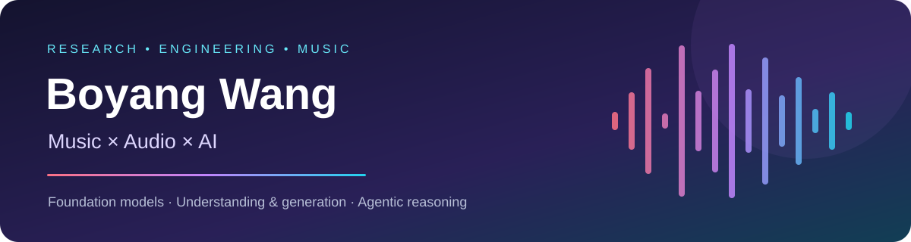

I work on **music and audio foundation models**, connecting model training, large-scale music data, controllable generation, and music understanding. I'm an M.S. Data Science student at **UC San Diego**, graduating in December 2026.

## 🎧 Selected research & contributions

### StepAudio 3 Music · Controllable music generation

**My contribution:** Designed music Chain-of-Thought data and ABC notation-based symbolic conditioning for controllable generation, including music-to-ABC and ABC-to-music tasks and structured representations of melody, harmony, rhythm, and form.

### HMU-Bench · Hierarchical music understanding

**Co-first author.** Co-developed a hierarchical benchmark for general music understanding. Extended MARBLE-style linear-probe infrastructure to evaluate musical information preserved in audio tokenizer representations.

### CSyMR · Compositional music retrieval & reasoning

**First author · SIGIR 2026.** Built a benchmark of 126 score-grounded questions and a ReAct agent with 16 music21 analysis tools. The tool-augmented agent reached **66.67% accuracy**, a **5.56 percentage-point** improvement over ReAct without music tools.

### SymSkill · Skill graphs for symbolic music understanding

**Co-author · ISMIR 2026.** Co-developed a system that distills music curricula into a skill graph of reusable analytical protocols. Evaluated on three benchmarks, with Qwen3.5-4B improvements of **4.76** and **3.27 percentage points** over the strongest baselines on CSyMR and MusicTheoryBench, respectively.

## 🛠️ What I work with

**Models:** PyTorch · Transformers · SFT · Megatron · vLLM · Audio tokenization · Flow Matching / DiT  
**Music:** MIR · Music understanding & generation · ABC / Kern / MusicXML / MIDI · music21  
**Systems:** Python · Linux · SQL · Data pipelines · Spark · Ray · Docker

Selected collaborative work is linked to its official project pages and publications. The descriptions above identify my contributions; source code and models are maintained by the respective project teams.
